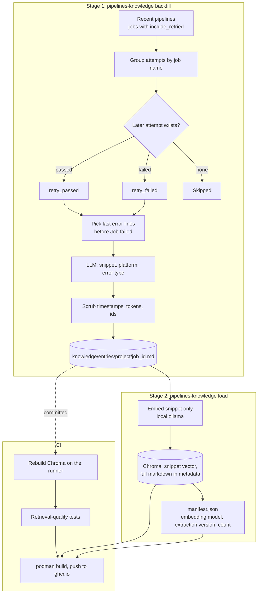

# Architecture

The offline half of pipelines-watch: it turns CI history into a retrieval
corpus and publishes it as an image. The online half (the watcher) is in
`gitlab-pipelines-watch`, see its `ARCHITECTURE.md`.

## Decisions

- **Entries are the source of truth.** They are small markdown files in git;
  Chroma is rebuilt from them in CI, so the database always matches the
  embedding model and no binary churns in history.
- **Labels come only from what a retry did.** `retry_passed` is strong evidence
  of a transient failure and `retry_failed` of a real bug. Failures never
  retried are skipped. The platform is part of every entry because the same
  error can be transient on one platform and a bug on another.
- **Only the snippet is embedded,** so similarity depends on the error and not
  on the surrounding text. The whole file is stored with the record and shown
  to the LLM as an example.
- **The root-cause line is chosen by code** (the last `ERROR` or `FATAL` lines
  before "Job failed"), then given to the LLM as a hint, because asking the LLM
  to rank several errors gave inconsistent labels.
- **Quality gates publishing.** The tests run after the rebuild and before the
  image is built.

## Known limits

- Many entries share identical snippets (277 distinct of 425), so the top
  results contain duplicates. They can carry different outcomes, which is useful
  evidence, but it reduces the variety of examples the LLM sees.
- An entry needs a job that was retried within its own pipeline, so projects
  where people restart whole pipelines yield few entries.
- The same error can have both outcomes (for example a corrupt git index on
  Windows runners), probably depending on which runner picks up the retry.
